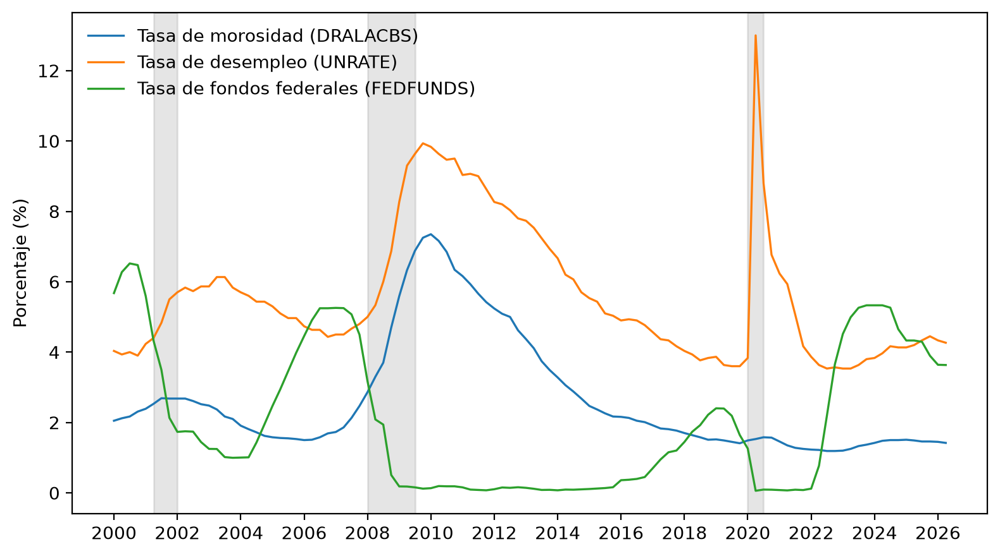
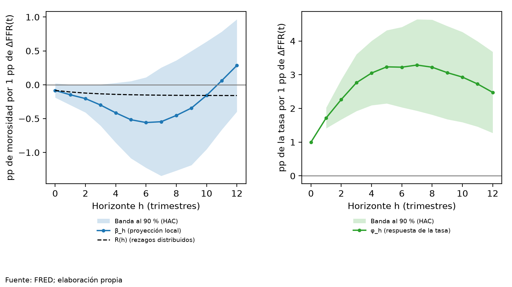
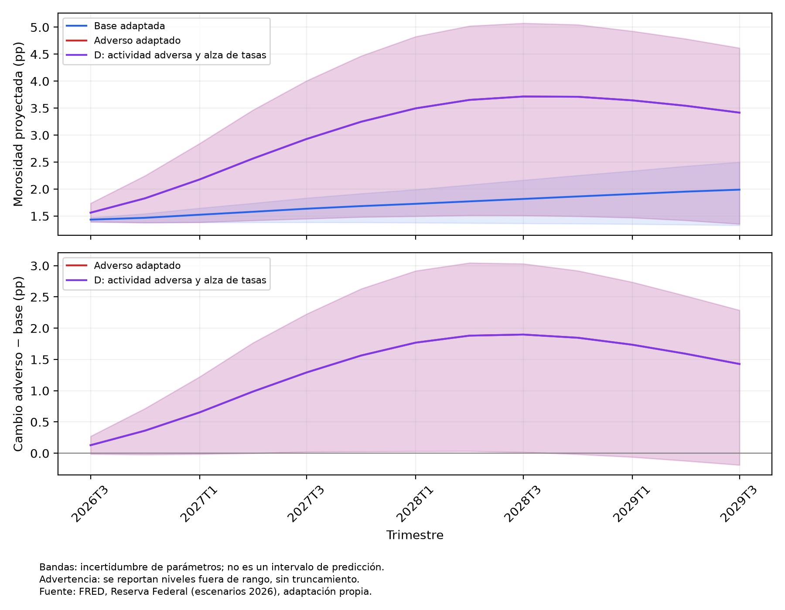
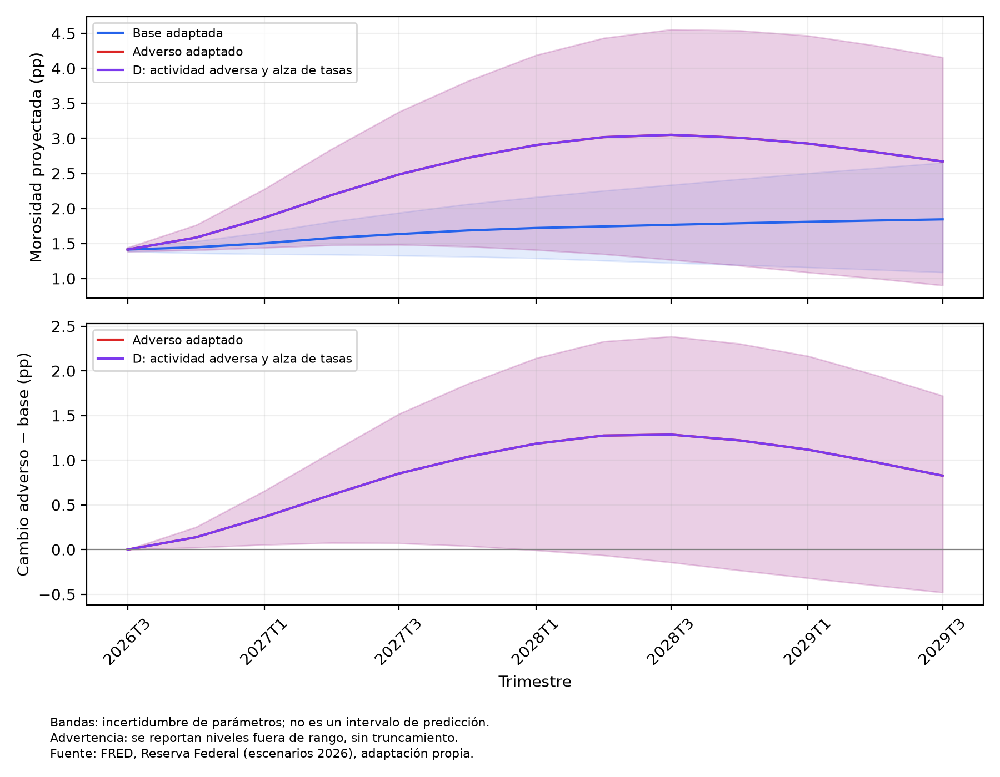

# 1. Introducción

La pregunta de este informe es en qué medida el ciclo macroeconómico y los cambios de la política monetaria de Estados Unidos se asocian con la morosidad bancaria, y cómo un gestor de riesgos puede usar esa información.

## El problema y su relevancia

La calidad de la cartera de un banco no depende solo de sus clientes.
Cuando la economía se desacelera, el desempleo sube y el crédito se encarece, más prestatarios dejan de pagar al mismo tiempo.
Ese movimiento común amenaza las utilidades, el capital y, si es amplio, la estabilidad del sistema financiero.
Por eso los supervisores y las instituciones financieras vigilan la morosidad y someten sus carteras a pruebas de estrés.

La teoría ofrece mecanismos para esa relación.
Las fricciones del crédito amplifican los ciclos y hacen que los efectos de una perturbación persistan [@bernanke1995; @kiyotaki1997].
La política monetaria puede alterar las condiciones de financiamiento, como el costo y la disponibilidad del crédito [@gertler2015].
La evidencia empírica disponible, en cambio, proviene sobre todo de paneles de países y de otros sistemas bancarios, y sus conclusiones no coinciden en todos los casos.
Este informe aporta una serie temporal trimestral de un solo país.

## Pregunta y objetivo

La pregunta de investigación, tal como la plantea la guía de la asignatura, es la siguiente: ¿en qué medida las condiciones macroeconómicas y los cambios en la política monetaria afectan el riesgo de crédito, y cómo pueden estos efectos ser utilizados para fortalecer la gestión y monitoreo del riesgo financiero?

El objetivo general es evaluar empíricamente la relación de las condiciones macroeconómicas y de la política monetaria con el riesgo de crédito, mediante modelos econométricos y escenarios de estrés.

El riesgo de crédito se mide con la tasa de morosidad de los préstamos bancarios de Estados Unidos (serie DRALACBS de FRED).
La muestra de estimación va de  a .
Las palabras «afectan» y «efecto» se leen aquí como asociación condicional entre variables observadas.
El trabajo no identifica mecanismos estructurales, y la variación observada de la tasa de política no es un shock identificado.

## Qué se hace y cómo se organiza el documento

Se estiman dos modelos de series de tiempo, con errores estándar robustos a heterocedasticidad y autocorrelación.
El primero relaciona la morosidad con el crecimiento del producto, el desempleo, la inflación, la política monetaria y el crédito.
El segundo estudia si los cambios de la tasa de fondos federales anticipan la morosidad posterior, es decir, si hay efectos rezagados.
Con ambos modelos se proyecta la morosidad bajo un escenario adverso y bajo uno base, y se calcula la diferencia.

El informe sigue las once secciones de la guía.
La revisión de literatura precede a la descripción de los datos y de la metodología.
Los modelos y su comparación ocupan las secciones intermedias, y el estrés y las implicaciones para la gestión de riesgos las cierran.
Las conclusiones responden la pregunta de investigación.

El informe explica los resultados y deja el respaldo completo en un anexo técnico separado.
Cada tabla o figura del anexo tiene un identificador estable, como **AT-M1-COEFFICIENTS**, y el texto remite a él.
Cada cifra del texto procede de los resultados que se documentan en el anexo.


# 2. Revisión de literatura

La literatura verificada documenta que el ciclo económico se relaciona con el riesgo de crédito y que la política monetaria se relaciona con las condiciones financieras y el costo del crédito, pero los estudios verificados sobre transmisión no miden la morosidad frente a la tasa de política, y no ofrece una magnitud única que sirva de referencia.
Solo se citan estudios cuya fuente se verificó; los candidatos sin verificar no se usan como evidencia.
En la mayoría de los casos la verificación se apoya en el resumen del estudio, y el Anexo E indica la base de cada uno.

## 2.1 Riesgo de crédito y ciclo económico

El riesgo de crédito se mueve con el ciclo porque las fricciones de información y las garantías amplifican las perturbaciones.
La teoría del canal del crédito sostiene que esas fricciones se agravan cuando el dinero se encarece y que ello refuerza el efecto de la política monetaria sobre la economía [@bernanke1995].
Este trabajo la resume como marco general de transmisión; la subsección sobre transmisión la retoma como apoyo secundario.
Un modelo dinámico con deuda garantizada muestra otra fuente de amplificación.
Cuando los activos sirven de garantía, en ese modelo, la interacción entre los límites de crédito y los precios de los activos da lugar a efectos persistentes que se transmiten a otros sectores [@kiyotaki1997].
Ninguno de los dos estudia la morosidad; sus mecanismos son coherentes con que la morosidad reaccione con retraso y de forma persistente, lo que es coherente con incluir su propio rezago en los modelos.

## 2.2 Determinantes macroeconómicos del riesgo de crédito

Los determinantes macroeconómicos entran al riesgo de crédito por el estado de los deudores.
Una línea de trabajo vincula el valor de los activos de las empresas de una cartera con un modelo macroeconométrico global.
En ella la probabilidad de impago depende de cómo las empresas se ligan a los ciclos económicos, y las pérdidas responden de forma asimétrica a los choques [@pesaran2006].
Otra línea propone incorporar los choques macroeconómicos a la medición del riesgo de cartera cuando faltan datos, y muestra su utilidad en ejercicios de estrés [@segoviano2006].
Ninguno de los dos estudia directamente la morosidad bancaria; se citan como marco para pasar de variables macroeconómicas a pérdidas de crédito y a escenarios de estrés.
La evidencia empírica sobre la morosidad se reúne en la última subsección.

## 2.3 Política monetaria y condiciones financieras

Una hipótesis de transmisión es que la política monetaria se asocia con la oferta de crédito antes que con la morosidad.
En datos de encuestas de la zona del euro y de Estados Unidos, las tasas oficiales de corto plazo bajas se asocian con estándares de crédito más laxos.
Esa asociación se amplifica con la securitización y con una supervisión débil del capital bancario, mientras que las tasas de largo plazo bajas no muestran el mismo patrón [@maddaloni2011].
La política no convencional también se asocia con el mercado laboral: un modelo no lineal de la estructura de tasas, aplicado a Estados Unidos, atribuye al estímulo de la Reserva Federal una menor tasa de desempleo [@wu2016].
Ambas lecturas indican que la postura de política y las condiciones financieras se relacionan con el entorno en que los deudores pagan.
Ninguna mide la morosidad.

## 2.4 Transmisión de la política monetaria al riesgo de crédito

La transmisión opera sobre el costo y la disponibilidad del crédito, y de ahí sobre la capacidad de pago.
Un modelo vectorial autorregresivo con shocks identificados por sorpresas de alta frecuencia muestra que movimientos modestos de las tasas cortas producen movimientos grandes en los costos del crédito.
Los costos reaccionan sobre todo por las primas de término y los diferenciales de crédito, y la orientación futura importa para la intensidad de la transmisión [@gertler2015].
Otro estudio, basado en eventos alrededor de las compras de bonos de la Reserva Federal, encuentra varios canales y asocia las compras de bonos con garantía hipotecaria con menores rendimientos y con menor riesgo de crédito corporativo [@krishnamurthy2011].
El canal del crédito de la primera subsección completa el marco [@bernanke1995].
Estos trabajos miden costos y estándares de crédito, no tasas de morosidad.
Por ello, tratar un cambio de la tasa de política como señal de deterioro posterior de la cartera es una hipótesis empírica que este informe contrasta con el Modelo II, no un resultado dado.

## 2.5 Evidencia empírica

Los estudios que estiman la morosidad bancaria en función de variables macroeconómicas usan sobre todo paneles de países o de bancos.
Esta subsección reúne  de ellos, con las variables y los métodos de cada uno.
La tabla siguiente resume los estudios de esta subsección, con su variable dependiente, sus regresores y su método.



La columna «Signo y contexto» recoge solo los signos verificables en cada estudio, y «—» indica que la tabla no los recoge.
Los signos que sí se pueden reportar se resumen en el texto que sigue.

**Variables.** La morosidad (NPL) es la variable dependiente en todos los estudios.
Los regresores más frecuentes son el crecimiento del producto, la inflación, el desempleo, el crecimiento del crédito, la deuda pública y los tipos de interés, a los que se suman variables propias de cada banco o país [@bayar2019; @zawadzki2023; @golitsis2022].
Tres estudios usan el tipo de cambio o la depreciación de la moneda [@tanaskovic2015; @obradovic2026; @zawadzki2023], y uno incluye los rendimientos del petróleo [@madbouly2020].

**Métodos.** Predominan los modelos de panel estáticos y dinámicos, con efectos fijos, mínimos cuadrados generalizados factibles o GMM de sistema [@obradovic2026; @tanaskovic2015; @bayar2019; @koju2018].
Otros usan mínimos cuadrados ordinarios, sobre un panel de países o sobre datos mensuales de un país, estos últimos en primeras diferencias por la no estacionariedad de las variables [@zawadzki2023; @tan2023].
Dos aplican series trimestrales, una con un modelo de regresión sobre siete bancos y otra con un modelo ARDL de pruebas de límites [@madbouly2020; @golitsis2022].
Uno combina paneles con un modelo vectorial autorregresivo de panel [@nkusu2011].

**Signos que la evidencia verificada permite reportar.** En la mayoría de los estudios cuyos signos son verificables, un mayor desempleo se asocia con más morosidad [@bayar2019; @zawadzki2023; @golitsis2022].
El crecimiento del producto se asocia con menos morosidad en dos de ellos [@bayar2019; @golitsis2022], pero con más en otro, que estudia siete bancos cotizados de Bahréin [@madbouly2020].
Para la inflación, un estudio halla un signo negativo [@bayar2019], otro positivo [@madbouly2020] y otro no lo precisa [@zawadzki2023].
En el estudio con ARDL, la tasa de interés se asocia con más morosidad en el largo plazo [@golitsis2022].
En el panel de nueve países del Sudeste de Europa, el tipo de interés de préstamo, que no es la tasa de política, se asocia con más morosidad [@obradovic2026].
Ese mismo estudio halla que el tipo de cambio oficial no tiene un efecto consistente sobre la morosidad y que el desempleo se asocia con menos morosidad, un resultado que los autores califican de inesperado y que atribuyen a un comportamiento de préstamo más prudente en períodos de incertidumbre y a los mecanismos de apoyo público [@obradovic2026].
Los signos son heterogéneos y dependen del país, del período y del método.
Eso obliga a leer cualquier signo esperado como una hipótesis y no como un resultado dado.

**Contraste con este trabajo.** La mayoría de los estudios usa países emergentes o paneles heterogéneos de países o de bancos.
Este trabajo usa Estados Unidos, frecuencia trimestral y una muestra de  trimestres, con dos modelos de series de tiempo y una prueba de estrés.
Los resultados no son comparables en magnitud con los de paneles de países.
Sirven para contrastar direcciones y para ubicar las variables de control.

**Estudios no usados como evidencia.** Los candidatos que no se pudieron verificar o que no respaldaban la subsección que los motivaba no se usan como evidencia.
Ninguno se cita con hallazgos.


# 3. Datos y metodología

## 3.1 Descripción de los datos

La investigación utiliza un panel trimestral de Estados Unidos, construido desde descargas congeladas de FRED [@fred2026].
La muestra común comprende –, con  trimestres.
El vintage corresponde a la descarga del ; no se incorporan revisiones posteriores.

Se descargaron  series, incluidas las utilizadas en robustez y en la contextualización gráfica.
Este conteo identifica códigos de origen; no cuenta columnas transformadas ni regresores de cada ecuación.
La historia congelada comienza en , antes de la ventana principal, para construir transformaciones y rezagos.

Las series mensuales se agregan mediante promedios del trimestre calendario.
La morosidad corresponde a información trimestral de fin de período; se declara esa diferencia frente a los promedios macroeconómicos.
FRED fecha cada trimestre en su primer día y el panel lo identifica por año y trimestre.

En 2025T4 faltan las observaciones de octubre para CPIAUCSL y UNRATE.
El promedio utiliza noviembre y diciembre:  meses para CPI y  para desempleo.
No se imputó octubre ni se rellenaron observaciones en silencio.
La cola incompleta queda fuera de la muestra común: .



La figura sitúa la morosidad en su contexto macroeconómico; su versión completa se identifica como **AF-DELINQUENCY-UNEMPLOYMENT-FFR**.



Los descriptivos completos están en **AT-DESCRIPTIVES** y las pruebas de estacionariedad en **AT-STATIONARITY**.


## 3.2 Variable dependiente

El riesgo de crédito se aproxima mediante DRALACBS, la tasa de morosidad de los préstamos bancarios [@fred2026].
Su unidad es el punto porcentual de morosidad; no constituye una estimación del monto de pérdidas en dólares.
El panel conserva su nivel y las transformaciones previstas para el análisis y las robusteces.

La dependiente principal entra en la misma forma en ambos modelos: .
Esta elección se conserva desde las especificaciones pre-registradas; no se modifica tras observar significancia o diagnósticos.
La combinación de ADF y KPSS y las advertencias sobre órdenes de integración se documentan en el Anexo A y las tablas de cada modelo.


## 3.3 Variables macroeconómicas

Las condiciones macroeconómicas se representan mediante actividad, desempleo, inflación, tasa de interés y crecimiento del crédito.
El PIB principal utiliza GDPC1, una medida real; GDP nominal permanece como contraste de robustez.
UNRATE representa el desempleo, CPIAUCSL el índice de precios, FEDFUNDS la tasa de fondos federales y LOANS el crédito [@fred2026].

El panel calcula la variación interanual logarítmica del PIB, del índice de precios y del crédito.
Las observaciones mensuales se agregan antes de transformar; desempleo y tasa se expresan en puntos porcentuales.
Las ecuaciones utilizan las diferencias y rezagos que fijaron sus respectivos pre-registros.
La transformación del panel y la forma final del regresor se distinguen expresamente en las tablas de estacionariedad de los modelos.

La «tasa de interés» y la variable de política monetaria no se incorporan como regresores distintos de forma redundante.
CORALACBS y las dependientes de subcarteras permanecen disponibles según su alcance de extensión o robustez.
USREC se utiliza para contextualizar gráficos, sin convertirse en un regresor añadido después de estimar.


## 3.4 Variable de política monetaria

La variable de política monetaria es ΔFFR, el cambio trimestral de la tasa de fondos federales.
La tasa procede de FEDFUNDS y se agrega al trimestre calendario antes de calcular su cambio [@fred2026].
Esta es también la medida de tasa de interés de la subsección anterior.

ΔFFR recoge movimientos observados de política monetaria, no un shock identificado de forma externa.
La política responde a las condiciones económicas; esa endogeneidad limita la interpretación de sus coeficientes.
Por ello, «efecto» y «respuesta» se utilizan como asociaciones condicionales dentro de los modelos estimados.


## 3.5 Metodología econométrica

El trabajo utiliza dos especificaciones complementarias: un modelo dinámico de determinantes macroeconómicos y otro con rezagos distribuidos de ΔFFR.
Ambos se estiman por mínimos cuadrados con errores HAC de Newey–West [@newey1987].
La persistencia se incorpora mediante el rezago de la dependiente y se mantienen los controles y dummies fijados antes de estimar.
Las dummies de impulso corresponden a .

Las ecuaciones siguientes describen las especificaciones fijadas antes de estimar; no añaden modelos ni regresores.
Para el Modelo I, Y representa la  de la morosidad:

$$
\begin{aligned}
Y_t &= \alpha + \rho Y_{t-1} + \beta_{PIB} PIB_t + \beta_U \Delta U_t + \beta_{\pi} \pi_t \\
    &\quad + \beta_{FFR}\Delta FFR_t + \beta_{CRED} CRED_{t-4}
      + \sum_{k\in\mathcal C}\delta_k D_{k,t} + \varepsilon_t.
\end{aligned}
$$

Aquí, PIB, inflación y crédito son variaciones interanuales logarítmicas; ΔU y ΔFFR son cambios trimestrales.
La forma de Y determina también la de su rezago. El conjunto C contiene los trimestres de impulso indicados arriba.

El Modelo II mantiene la dependiente en primera diferencia y rezaga los controles macroeconómicos:

$$
\begin{aligned}
\Delta DR_t &= \alpha + \rho\Delta DR_{t-1}
 + \sum_{j=0}^{K}\theta_j\Delta FFR_{t-j} \\
 &\quad + \gamma_{PIB}PIB_{t-1} + \gamma_U\Delta U_{t-1} + \gamma_{\pi}\pi_{t-1} \\
 &\quad + \gamma_{CRED}CRED_{t-4}
 + \sum_{k\in\mathcal C}\delta_k D_{k,t} + \varepsilon_t.
\end{aligned}
$$

K procede del criterio BIC sobre la muestra común de selección; no se vuelve a seleccionar para las robusteces.
Las proyecciones locales usan las dos dependientes acumuladas previstas, con el mismo cambio contemporáneo de tasa:

$$
\begin{aligned}
DR_{t+h}-DR_{t-1} &= a_h+\beta_h\Delta FFR_t+b_h'Z_t+u_{t,h}, \\
FFR_{t+h}-FFR_{t-1} &= c_h+\phi_h\Delta FFR_t+d_h'Z_t+v_{t,h}.
\end{aligned}
$$

Z contiene el cambio rezagado de morosidad, PIB, desempleo e inflación rezagados, crédito rezagado,
los cambios rezagados de tasa hasta K y las dummies fechadas en el trimestre de origen.
β y φ son asociaciones condicionales; su interpretación y las bandas se discuten en la sección del Modelo II.

El Modelo I distingue la asociación contemporánea de su acumulación dinámica.
El Modelo II compara estructuras de rezagos según los criterios predefinidos y usa BIC para su especificación principal.
Las proyecciones locales complementan la descripción de la respuesta por horizonte, con incertidumbre HAC [@jorda2005].
No se eliminan regresores por resultados inesperados ni se realizan nuevas selecciones para mejorar la lectura del informe.

Se declaran las diferencias frente a la guía: GDPC1 real como principal, GDP nominal como robustez y LOANS como serie de crédito elegida.
La muestra termina en , el último trimestre común de las fuentes congeladas.
Este corte supera el inicio de trimestre 2026T1 indicado por la guía; no se presenta como una muestra con el mismo cierre.
La historia disponible comienza en ; no se presenta la robustez de muestra larga como estimada si falta historia.
Las formas fijas de ciertos regresores y la lectura conjunta de estacionariedad se conservan como desviaciones y límites del pre-registro.

Las desviaciones completas están en **AT-M1-DEVIATIONS** y **AT-M2-DEVIATIONS**.
Los diagnósticos y limitaciones se presentan junto a los resultados y no quedan ocultos por separar el anexo técnico.


**Limitaciones de la metodología.**

Los dos modelos son lineales, en primera diferencia, y se estiman por mínimos cuadrados con errores estándar de Newey–West.
Esos errores corrigen la covarianza, no la especificación.
Si la forma funcional es inadecuada o la relación cambia en el tiempo, los coeficientes siguen siendo asociaciones condicionales de la muestra y no parámetros estables.

Los diagnósticos del Modelo I no avalan una especificación limpia.
Pasa la prueba de autocorrelación de Breusch–Godfrey; fallan las de heterocedasticidad de Breusch–Pagan y White, la de normalidad de Jarque–Bera, la de forma funcional RESET y los dos contrastes de quiebre de Chow, en 2008T3 y en 2020T2.
El CUSUM no detecta inestabilidad.
No es una contradicción: ese contraste tiene poca potencia frente a quiebres en las pendientes.
El detalle está en **AT-M1-DIAGNOSTICS**.

El Modelo II tiene un patrón parecido.
Pasan la autocorrelación, el Chow de 2008T3 y el CUSUM; fallan Breusch–Pagan, White, Jarque–Bera, RESET y el Chow de 2020T2 (**AT-M2-DIAGNOSTICS**).
La conclusión de «sin evidencia» del Modelo II procede de una regla fijada antes de estimar, aplicada a un modelo lineal mal especificado e inestable.
Se discute en la sección sobre el Modelo II.

El factor de inflación de varianza de la variación del desempleo es  en el Modelo I.
Es una alerta que refleja la colinealidad con las variables indicadoras de la pandemia, no un problema de datos de la serie.
Esas variables indicadoras absorben los trimestres de la pandemia ().
Por eso el ajuste del modelo, con un R² de , no mide el poder explicativo de las variables macroeconómicas; las indicadoras lo inflan.
No existe una cifra del ajuste sin ellas en los resultados del informe.

El ejercicio fuera de muestra del Modelo I usa un tramo de entrenamiento cuyos coeficientes no se exportaron.
Por eso el informe no explica con cifras por qué el pronóstico dinámico no supera al ingenuo más allá de lo que muestran las salidas.

La variación observada de la tasa de fondos federales no es un shock de política monetaria identificado.
La Reserva Federal responde al ciclo, de modo que la dirección de la asociación puede reflejar esa reacción.
Las proyecciones locales estiman, por horizonte, la asociación condicional entre la morosidad futura y ΔFFR(t).
La trayectoria posterior de la tasa que acompaña a esa variación describe la continuación observada en la muestra.
No identifica un shock externo ni una secuencia de política determinada.
Se interpreta en la sección sobre el Modelo II.

En el Modelo I, el producto, el desempleo, la inflación y la tasa entran en el mismo trimestre que la morosidad y se determinan junto con ella; la estimación no resuelve esa simultaneidad.
En el Modelo II, la tasa casi no varía en los tramos con tasa cercana a cero, lo que reduce la potencia para detectar efectos.
Los efectos base de los trimestres posteriores a la pandemia, como el rebote del producto y el crédito asociado al programa de protección de nóminas, no llevan variable indicadora.

El número de observaciones es limitado:  en el Modelo I y  en el Modelo II.
Los resultados pueden depender de pocos episodios, como la crisis financiera y la pandemia.
Las series de FRED se revisan; el vintage del  puede dar resultados distintos si se descarga de nuevo.

En el estrés, las bandas reflejan la incertidumbre de los parámetros y omiten otras fuentes de incertidumbre.
El trabajo no calcula un equivalente en dólares del cambio de morosidad ni un estimador restringido.
Esas ausencias son límites del alcance y no se compensan con cifras nuevas.


# 4. Modelo I: Determinantes macroeconómicos del riesgo de crédito

El Modelo I encuentra que la inflación y el crecimiento rezagado del crédito se asocian con aumentos de la morosidad, que el producto muestra una asociación negativa solo en el largo plazo, y que el desempleo y la política monetaria no tienen una asociación distinguible de cero.
Todas son asociaciones condicionales de una muestra pequeña y con diagnósticos que fallan; no son efectos estructurales.

## La pregunta y el modelo

La guía pregunta cómo afectan las condiciones macroeconómicas al comportamiento del riesgo de crédito.
«Afectan» se lee aquí como asociación condicional entre variables observadas.
La variable dependiente es el cambio trimestral de la tasa de morosidad, medido en puntos porcentuales (pp), porque la serie entra con la transformación .
Los regresores son el crecimiento del producto, el cambio del desempleo, la inflación, el cambio de la tasa de fondos federales (ΔFFR) y el crecimiento del crédito rezagado cuatro trimestres.
El modelo incluye el rezago de la dependiente y variables indicadoras para .
Se estima con  observaciones de  a , por mínimos cuadrados con errores de Newey–West de  rezagos [@newey1987].
La persistencia es alta: el coeficiente del rezago de la morosidad es  (valor p ).

## Coeficientes y significancia



La tabla muestra el efecto de impacto: lo que se asocia con un punto de cambio del regresor en la variación de la morosidad del mismo trimestre.
Como la morosidad persiste, el efecto de largo plazo acumula esa asociación en el nivel de la morosidad.
Se distingue entre ambos al hablar de significancia, porque no siempre coinciden.
Las bandas de incertidumbre salen de errores HAC; la tabla completa, con las variables indicadoras, está en **AT-M1-COEFFICIENTS**, y los efectos de largo plazo en **AT-M1-EFFECTS**.

**Inflación.** Un punto más de inflación interanual se asocia con  pp más de variación trimestral de la morosidad (valor p ).
La asociación acumulada en el nivel es de  pp (valor p ).
Para dar una escala, un aumento de una desviación estándar de la inflación, de  puntos, se asocia con  pp de variación trimestral de la morosidad y con  pp acumulados.
El pre-registro no fijó un signo esperado, porque la inflación puede reducir la carga real de la deuda o anticipar alzas de tasas y menor ingreso real.
El signo positivo observado no distingue entre esos mecanismos.

**Crédito.** Un punto más de crecimiento del crédito, rezagado cuatro trimestres, se asocia con  pp más de variación de la morosidad (valor p ).
En el largo plazo la asociación acumulada es de  pp.
Una desviación estándar del crecimiento del crédito, de  puntos, se asocia con  pp de variación trimestral y con  pp acumulados.
Concuerda con la hipótesis de que las expansiones rápidas relajan los estándares y la mora aparece con retraso.

**Producto.** El crecimiento del producto tiene el signo esperado, negativo.
Su efecto de impacto es de  pp y no es significativo (valor p ).
Su efecto de largo plazo es de  pp y sí es significativo (valor p ).
La respuesta sobre significancia depende, por tanto, de cuál efecto se mire.

**Desempleo.** El cambio del desempleo tiene el signo esperado, positivo, pero no es significativo ni de impacto ( pp, valor p ) ni de largo plazo (valor p ).
El desempleo varía poco fuera de la pandemia, lo que limita su identificación estadística; no equivale a evidencia de que no importe.
En el Modelo II, la variación rezagada del desempleo sí es significativa (sección 6), así que la evidencia sobre esta variable es mixta.

**Política monetaria.** El cambio contemporáneo de la tasa de fondos federales tiene signo negativo, contrario al esperado, y no es significativo ( pp, valor p ).
No se interpreta como una señal de que las alzas de tasas reduzcan la morosidad.
La tasa responde al ciclo, y el Modelo II examina los efectos rezagados.

## Robustez

Se reestimó el modelo con nueve variantes: una muestra sin la pandemia, otras definiciones de la dependiente, el producto nominal y distintos rezagos del crédito.
Una variante es robusta cuando mantiene el signo de la principal y es significativa al diez por ciento con errores HAC.
Contando el coeficiente de impacto, la inflación se sostiene en  variantes y el crédito en .
El producto lo hace en , el desempleo en  y la política monetaria en .
La variante sin la pandemia es un contraste parcial: conserva como rezagos valores de los trimestres excluidos.
El rebote del producto y el crédito asociado al programa de protección de nóminas entran sin variable indicadora, lo que puede afectar sobre todo a la lectura del crédito (**AT-M1-LIMITATIONS**).
Una variante de muestra larga no se pudo estimar porque la historia congelada no la cubre.
Las inferencias sobre inflación y crédito son, entonces, las más robustas a las variantes.
El detalle y las notas de cada variante están en **AT-M1-ROB** y **AT-M1-ROBUSTNESS-SUMMARY**.
La columna de motivo de la primera de ellas queda vacía en las variantes estimadas por diseño; solo la variante no estimada lleva motivo.

## Diagnósticos



Los diagnósticos no respaldan una especificación limpia.
Pasa la autocorrelación (valor p ).
Fallan la heterocedasticidad de Breusch–Pagan (valor p ) y de White, la normalidad de Jarque–Bera, la forma funcional RESET (valor p ) y los dos contrastes de quiebre de Chow, en 2008T3 (valor p ) y en 2020T2 (valor p ).
El CUSUM no detecta inestabilidad ().
Esto no contradice los Chow: el CUSUM tiene poca potencia frente a quiebres en las pendientes.
El Chow de 2020T2 se apoya en pocos trimestres posteriores a esa fecha frente al número de restricciones, así que su tamaño real puede diferir del nominal; se lee como señal de inestabilidad y no como prueba exacta.
El factor de inflación de varianza del desempleo es .
Refleja la colinealidad con las variables indicadoras de la pandemia, no un problema de datos.
Los errores HAC corrigen la covarianza, no la forma funcional ni los quiebres.
Tampoco resuelven la simultaneidad: el producto, el desempleo, la inflación y la tasa entran en el mismo trimestre que la morosidad y se determinan junto con ella (**AT-M1-LIMITATIONS**).
Por eso los p-valores se leen con cautela.
Las pruebas completas y las figuras de estabilidad están en **AT-M1-DIAGNOSTICS** y **AF-M1-CUSUM**.

La regresión es desbalanceada: la dependiente entra en primera diferencia y dos regresores, la inflación y el crecimiento del crédito, quedan clasificados como no estacionarios por la regla conservadora de la prueba ADF.
La prueba KPSS, sin embargo, tampoco rechaza su estacionariedad, de modo que la evidencia es ambigua y se dicen ambas cosas.
Son justamente las dos variables con asociación más significativa, así que sus p-valores deben leerse con esa ambigüedad.
El tratamiento completo está en **AT-M1-STATIONARITY**.

## Ajuste y evaluación fuera de muestra

El R² es , pero lo inflan las variables indicadoras de la pandemia.
No mide cuánto explican las variables macroeconómicas.
En la evaluación fuera de muestra, el modelo reduce ligeramente el error de pronóstico a un trimestre frente a un pronóstico ingenuo: el cociente de errores es  y el resultado se califica como «», pero «».
En el pronóstico dinámico de varios trimestres, el cociente es  y el modelo no supera al ingenuo.
Por eso el modelo sirve para describir asociaciones y para escenarios condicionales, no como instrumento de pronóstico.
El detalle está en **AT-M1-OOS** y **AF-M1-OOS**.

## Lectura para la gestión del riesgo

Con esas salvedades, el Modelo I sugiere tres lecturas para un gestor de riesgos.
Primera, la inflación y el crecimiento del crédito rezagado son las variables con asociación más robusta a las variantes con el deterioro de la cartera; el crédito, además, la anticipa por su rezago de cuatro trimestres.
Segunda, la actividad se asocia con la morosidad sobre todo de forma acumulada y con respaldo más débil, así que una desaceleración sostenida importa más que una caída de un trimestre.
Tercera, el modelo no permite afirmar que una alza de tasas reduzca la morosidad, ni que el desempleo carezca de relación con ella.


# 5. Modelo II: Política monetaria y riesgo de crédito

El Modelo II no encuentra evidencia de que los cambios de la tasa de fondos federales anticipen un deterioro posterior de la morosidad, según una regla fijada antes de estimar.
Ese resultado no prueba que la política monetaria carezca de relación con la morosidad: el modelo lineal presenta fallas de especificación e inestabilidad, y la variación observada de la tasa no es un shock identificado.

## La pregunta y el modelo

La guía pregunta cómo afectan los cambios de la política monetaria al riesgo de crédito y si existen efectos rezagados sobre la calidad de la cartera.
Aquí se pregunta si un cambio de la tasa de fondos federales tiene relación con el deterioro posterior de la morosidad.
«Afecta» y «efecto» se leen como asociación condicional; la guía habla de un shock, pero ΔFFR es el cambio observado de la tasa, no un shock de política identificado.

El modelo explica el cambio trimestral de la morosidad, en puntos porcentuales (pp), con el cambio contemporáneo de la tasa y sus rezagos, el rezago de la morosidad, el crédito rezagado cuatro trimestres y versiones rezagadas de los controles del Modelo I (producto, desempleo e inflación).
El número de rezagos de la tasa, K, se elige por el criterio BIC y resulta ; el criterio AIC elige .
Como ambos coinciden, no hace falta una variante de robustez por selección de rezagos.
Se estima con  observaciones de  a , por mínimos cuadrados con errores de Newey–West de  rezagos [@newey1987].
Los coeficientes y la selección completos están en **AT-M2-COEFFICIENTS** y **AT-M2-SELECTION**.

## Efectos rezagados

El coeficiente del cambio contemporáneo de la tasa es  pp por punto de ΔFFR (valor p ).
El del cambio del trimestre anterior es  pp (valor p ).
Ninguno es significativo.
La suma de ambos, el efecto acumulado, es  pp (valor p ).
La hipótesis pre-registrada esperaba una suma positiva, y el signo puntual es negativo.
La parte rezagada sola, que es lo que interesa para anticipar el deterioro, es  pp (valor p ).



La lectura de «¿hay efectos rezagados?» usa solo la parte rezagada y dos condiciones fijadas antes de ver los resultados.
La primera es que la prueba de Granger rechace.
La segunda es que la suma rezagada sea positiva y significativa.
La prueba de Granger no rechaza: el estadístico es  con valor p .
Con un solo rezago, la prueba de Granger y la segunda condición usan el mismo contraste de Wald; la diferencia es el signo.
Un rechazo con suma rezagada negativa cumpliría solo la primera condición y daría «evidencia parcial», con la marca de signo contrario al esperado; un rechazo con suma positiva cumpliría ambas y daría «evidencia fuerte».
Ninguna condición se cumple y la lectura es «».

El trimestre de mayor cambio de la morosidad tras un movimiento de la tasa es el mismo trimestre del movimiento, h = , y no uno posterior.
La respuesta acumulada del nivel de la morosidad a los doce trimestres es  pp por punto de ΔFFR, sin bandas de incertidumbre en esta trayectoria.
Las bandas las da la proyección local.

## Proyecciones locales



La figura compara la respuesta de la morosidad (izquierda) con la trayectoria de la tasa (derecha) por horizonte, con bandas del noventa por ciento.
La respuesta estimada de la morosidad es negativa en los primeros horizontes y cambia de signo hacia el final, hasta  pp a los doce trimestres.
Las bandas incluyen el cero en todos los horizontes; ningún horizonte detecta una respuesta distinta de cero.
En los horizontes 1 a 3 el límite superior de la banda queda muy cerca de cero (,  y  pp) sin llegar a excluirlo: una asociación negativa casi en el borde de lo distinguible, que debe leerse junto con la endogeneidad de la tasa.
La respuesta de las proyecciones locales y la del modelo de rezagos distribuidos tienen el mismo signo en  horizontes estimados.
Ambas son estimaciones descriptivas y no se prueba la forma paramétrica.

Los dos objetos no son iguales.
La respuesta acumulada del modelo mantiene fijas la tasa posterior y los controles.
La proyección local, β, es la asociación condicional de la morosidad futura con ΔFFR(t) e incluye la trayectoria posterior de la tasa y la reacción de los controles.
Esa trayectoria, φ, describe la continuación observada de la tasa en la muestra.
Por ejemplo, un punto de ΔFFR(t) se acompaña, en promedio, de una tasa  pp más alta, respecto de su nivel previo, cuatro trimestres después.
Por eso β a ese horizonte se lee a la escala de esa trayectoria: es la asociación con el inicio de una tasa que sigue subiendo, no con un cambio aislado de un punto.
Esa continuación describe lo observado en la muestra; no identifica un shock externo ni una secuencia de política.
En el horizonte inicial, φ vale  por construcción: es una identidad, sin error estándar ni banda, y no un resultado estimado.
Los valores de los demás horizontes sí se estiman y están en **AT-M2-LP**.

## Qué sobrevive a los diagnósticos

El resultado «sin evidencia» procede de una regla fijada antes de estimar, aplicada a un modelo lineal.
Los diagnósticos de ese modelo no son limpios.
Pasan la autocorrelación (valor p ), el Chow de 2008T3 y el CUSUM.
Fallan Breusch–Pagan, White, Jarque–Bera, RESET (valor p ) y el Chow de 2020T2 (valor p ); como pocos trimestres siguen a esa fecha, el tamaño real de este último contraste puede diferir del nominal.
El factor de inflación de varianza del desempleo rezagado es , una alerta de colinealidad; en el Modelo I, ese factor refleja las variables indicadoras de la pandemia.
El detalle está en **AT-M2-DIAGNOSTICS** y **AF-M2-CUSUM**.

Con RESET y el Chow de 2020T2 en contra, «sin evidencia» significa que el modelo no detecta una relación rezagada, no que se haya demostrado su ausencia.
Una forma funcional incorrecta o un cambio de pendiente pueden ocultar una relación existente o crear una aparente.
Los errores HAC corrigen la covarianza, no esas fallas.
Por eso la conclusión sobrevive solo como un resultado de este modelo y de esta muestra.

Hay además tres límites que condicionan la lectura.
En los tramos con la tasa cercana a cero, ΔFFR casi no varía, y los coeficientes de la tasa se identifican con pocos trimestres: es un límite de potencia.
La inferencia no incorpora la incertidumbre de haber elegido K con los mismos datos, y los efectos base de los trimestres posteriores a la pandemia no llevan variable indicadora; esos dos son límites de la inferencia y de la especificación, no de potencia.
Dos variantes de robustez contrastan dos de ellos: una sin los tramos de tasa cercana a cero, con  observaciones, y otra sin los trimestres de la pandemia, con , que sirve de contraste para el efecto base.
Ninguna variante trata la elección de K, porque la selección alternativa no aplica: los criterios de información eligen el mismo K.
En ninguna la parte rezagada es significativa (valor p  y ), de modo que la lectura no cambia, aunque la variante sin tasa cercana a cero tiene menos potencia.
Las ventanas de resultado de las proyecciones locales que tocan 2020T2–2021T1 arrastran además el efecto de la pandemia, porque no llevan variable indicadora.
El detalle está en **AT-M2-LIMITATIONS** y **AT-M2-ROBUSTNESS-SUMMARY**.

## Endogeneidad y alcance

El signo puntual negativo del efecto acumulado es compatible con que la Reserva Federal reaccione al ciclo.
Si la tasa sube cuando la economía mejora y la morosidad ya baja, el modelo asociaría alzas con menor morosidad sin que la tasa la reduzca.
Con los datos disponibles no se puede separar esa reacción de un efecto de la tasa.
Tampoco se interpreta como respaldo de que subir tasas mejore la cartera.

La tabla de estacionariedad del Modelo II, en el anexo, contiene una columna que indica el panel probado.
Esa columna puede nombrar la serie base o su versión diferenciada; debe leerse como la columna del panel sobre la que se aplicó la prueba y no como la serie original (**AT-M2-STATIONARITY**).

## Lectura para la gestión del riesgo

El Modelo II no ofrece una regla de alerta basada en la tasa de política.
Un movimiento de la tasa no anticipa, en esta muestra y con este modelo, un deterioro posterior de la cartera.
Por prudencia, el estrés de la sección 7 no atribuye a la tasa un efecto estimado distinto de cero, y la sensibilidad con el coeficiente puntual se presenta aparte y rotulada.
El monitoreo de la tasa sigue siendo útil por su relación con las condiciones financieras y con el ciclo, no como señal propia de morosidad.


# 6. Análisis de resultados

Los dos modelos indican que parte del entorno macroeconómico se asocia de forma robusta a las variantes con la morosidad, mientras que la política monetaria no muestra una asociación distinguible de cero en esta muestra.
Los modelos se integran sin ponderarlos ni elegir uno, porque difieren en la muestra y en la forma de los controles.

## 6.1 Resultados del Modelo I

El Modelo I relaciona el cambio trimestral de la morosidad con condiciones macroeconómicas contemporáneas.
La inflación y el crecimiento del crédito rezagado cuatro trimestres tienen asociaciones positivas y significativas.
Un punto más de inflación se asocia con  pp más de variación trimestral de la morosidad.
Un punto más de crecimiento del crédito rezagado se asocia con  pp.
Ambas variables son también las más estables en las variantes de robustez: la inflación en  y el crédito en .
El crecimiento del producto tiene el signo esperado y solo es significativo en el largo plazo.
El desempleo tiene el signo esperado pero no es significativo, y el cambio de la tasa tiene signo contrario al esperado y tampoco lo es.
Los diagnósticos de heterocedasticidad, normalidad, forma funcional y estabilidad fallan; los detalles están en la sección 4.

## 6.2 Resultados del Modelo II

El Modelo II pregunta si los cambios de la tasa de fondos federales anticipan la morosidad posterior.
La suma de los efectos de la tasa es  pp, con valor p , y su parte rezagada es  pp, con valor p .
La prueba de Granger no rechaza, y la regla pre-registrada concluye «».
Las proyecciones locales no detectan una respuesta distinta de cero en ningún horizonte.
Como en el Modelo I, fallan los diagnósticos de heterocedasticidad, normalidad y forma funcional, y también el contraste de quiebre de 2020T2.
Por eso la lectura de «sin evidencia» es la de este modelo en esta muestra, no una demostración de ausencia.
El desarrollo está en la sección 5.

## 6.3 Comparación de resultados

Los dos modelos comparten el cambio contemporáneo de la tasa de fondos federales, el rezago de la morosidad y el crecimiento del crédito rezagado cuatro trimestres.
Difieren en que el Modelo I usa el producto, el desempleo y la inflación del mismo trimestre, y el Modelo II los rezaga un trimestre y añade el rezago de la tasa.
El único término de política monetaria que aparece en ambos es el cambio contemporáneo de la tasa.



En ambos modelos el coeficiente es negativo, contrario a la expectativa pre-registrada, y no es significativo:  pp con valor p  en el Modelo I, y  pp con valor p  en el Modelo II.
La coincidencia de signo y de falta de significancia apunta en la misma dirección.
Pero no es una confirmación independiente, porque los dos modelos usan casi los mismos datos.

Los modelos difieren en la muestra y en los controles.
El Modelo I tiene  observaciones y controles contemporáneos del producto, el desempleo, la inflación y el crédito rezagado.
El Modelo II tiene  observaciones, una menos que el Modelo I porque la selección de rezagos compara hasta ocho rezagos de la tasa sobre una muestra común, y rezaga los controles.
Por ello los dos coeficientes no miden lo mismo y no se promedian ni se elige entre ellos.

Los modelos se complementan.
El Modelo I describe qué condiciones se asocian con la morosidad del mismo trimestre.
El Modelo II mira hacia adelante: si la tasa anticipa la morosidad.
Para la gestión del riesgo, el primero informa qué vigilar; el segundo advierte que la tasa por sí sola no es una señal anticipada con la evidencia disponible.
Los controles del Modelo II no tienen hipótesis de signo pre-registrada, pero sus coeficientes también se informan.
La inflación rezagada ( pp, valor p ) y el crecimiento del crédito rezagado ( pp, valor p ) tienen asociaciones positivas y significativas, como en el Modelo I.
El producto rezagado ( pp, valor p ) tiene signo positivo, opuesto al del Modelo I, y no se distingue de cero: la asociación del producto con menos morosidad aparece solo en el Modelo I y no se confirma en el Modelo II.
En el desempleo los modelos difieren: el Modelo I no lo distingue de cero, y el Modelo II sí distingue su variación rezagada ( pp, valor p ), con una alerta de colinealidad en ese regresor, que infla su error estándar y no explica su significancia.
La evidencia sobre el desempleo es, por tanto, mixta y depende de la especificación.
La coincidencia para la inflación y el crédito no es una confirmación independiente, porque los datos son casi los mismos.

## 6.4 Discusión económica de los resultados

La pregunta fundamental es si los resultados econométricos proporcionan evidencia de que el entorno macroeconómico y la política monetaria son factores relevantes para el riesgo de crédito.
La respuesta es diferenciada y se formula como asociación, no como efecto estructural.

**El entorno macroeconómico.** Hay evidencia de asociación para la inflación y el crecimiento del crédito: aparece en los dos modelos, y las dos sobreviven a las variantes de robustez del Modelo I.
El producto muestra una asociación negativa acumulada en el Modelo I, coherente con el mecanismo de ingresos y capacidad de pago, pero débil: no es significativa en el impacto, se mantiene en  variantes de robustez y el Modelo II no la confirma con el producto rezagado.
El desempleo da una evidencia mixta: el Modelo I no lo distingue de cero y el Modelo II sí distingue su variación rezagada, con una alerta de colinealidad que infla su error estándar y no explica su significancia.
Como varía poco fuera de la pandemia, el resultado depende de la especificación y no prueba ni irrelevancia ni relevancia.
La evidencia de la literatura revisada va en la misma dirección en los signos que son verificables: más desempleo y menos crecimiento se asocian con más morosidad, aunque con heterogeneidad entre países y métodos.

**La política monetaria.** No hay evidencia de asociación distinguible de cero ni contemporánea ni rezagada.
El signo es negativo en ambos modelos, contrario al esperado.
Un modelo con RESET y quiebres en contra, y una tasa que responde al ciclo, no permite separar un efecto de la tasa de la reacción de la política al entorno.
La literatura sobre transmisión sugiere que la política opera sobre el costo y la disponibilidad del crédito, que no se observan aquí; el informe no contradice ese canal ni lo confirma.

**Asociación y no efecto estructural.** Los coeficientes son asociaciones condicionales dentro de modelos lineales que fallan varios diagnósticos.
La variación observada de la tasa no es un shock identificado.
Por eso ningún resultado se lee como el efecto que tendría intervenir una variable.

Esta discusión permite responder las preguntas que un lector crítico puede plantear.

*¿Por qué creer los p-valores de la inflación y del crédito si no son estacionarias en la regla conservadora?*
No se toman al pie de la letra.
Las pruebas de estacionariedad son ambiguas, y esas dos variables son justo las más significativas.
Su estabilidad en las variantes de robustez refuerza la asociación, pero no elimina la ambigüedad.

*¿Cómo usar el Modelo I en un estrés con alzas de tasas si el coeficiente de la tasa es negativo?*
No se usa.
Un signo contrario al esperado y no significativo no se emplea como efecto estimado.
El estrés de la sección 7 fija el efecto de la tasa en cero por la regla pre-registrada, que lo anula mientras la lectura del Modelo II no sea de evidencia fuerte, y presenta aparte una sensibilidad rotulada como tal.

*¿Qué afirmación para la gestión de riesgos sobrevive a la endogeneidad, la inestabilidad y la no linealidad?*
La de dirección y orden de magnitud para la inflación y el crédito rezagado, que no dependen de un solo modelo ni de una sola variante, y la alta persistencia de la morosidad.
No sobreviven las magnitudes como pronóstico, ni cualquier afirmación sobre el efecto de la tasa.

*¿Subir las tasas reduce la morosidad según el Modelo II, y cómo se separa de la endogeneidad?*
El signo puntual es negativo, pero no es significativo y es compatible con que la política reaccione al ciclo.
Con estos datos no se separa; por eso no se afirma que las alzas reduzcan la morosidad.

*¿Qué cambia en los niveles si el escenario parte de 2025T4 o de 2026T2, y por qué no cambia la diferencia?*
La sección 7 lo responde con las condiciones en que se cumple.

En síntesis, el entorno macroeconómico es un factor relevante para la morosidad en la medida en que la inflación y el crédito se asocian con ella de forma robusta a las variantes.
La política monetaria no muestra, en estos modelos, una asociación propia que sirva como señal.
Ambas conclusiones son condicionales a especificaciones imperfectas y a una muestra con pocos episodios.


# 7. Análisis de escenarios y pruebas de estrés

Bajo la adaptación del escenario Fed 2026, los dos modelos proyectan una morosidad más alta en el escenario adverso que en el base: el cambio al final del horizonte es  pp con el Modelo I y  pp con el Modelo II.
Son proyecciones condicionales a los escenarios y a los coeficientes estimados, con incertidumbre solo de parámetros; no son pronósticos.

## Escenarios

La prueba parte del último trimestre con datos comunes, , y proyecta  trimestres, de  a .
Los escenarios base y adverso son una adaptación del escenario Fed 2026: usan las trayectorias supervisoras definitivas de la Reserva Federal para 2026, que la propia Fed describe como hipótesis de trabajo y no como pronósticos [@frb2026].
La adaptación desplaza solo la etiqueta de calendario: el primer trimestre de la trayectoria de la Fed pasa a ser el primero posterior al origen.
Los valores de las trayectorias no se modifican.
Se hizo así porque los primeros trimestres de 2026 ya son datos observados y no siguieron ninguna de las dos trayectorias.
El resultado no es una publicación de la Fed, y la base de la Fed no coincide con lo ocurrido en esos trimestres.

El escenario adverso responde a la guía en lo que se refiere a actividad: deterioro económico y mayor desempleo, según la trayectoria severamente adversa de la Fed.
En esa trayectoria, sin embargo, la inflación y la tasa de política bajan.
El ejemplo de la guía, con aumento de la tasa, queda cubierto por un segundo escenario adverso propio, el escenario D.
D conserva del adverso la actividad, el desempleo y la inflación, y solo cambia la tasa.
Su ΔFFR toma los cambios observados de la tasa en el ciclo de alzas de 2022T1–2023T3, con  trimestres de alza que, en la proyección, van de  a .
Después, los  trimestres restantes tienen ΔFFR igual a cero, por un supuesto explícito y no por una predicción.
Esas fechas son las de la trayectoria proyectada, no las del episodio histórico.
D no es un escenario estanflacionario, porque no incorpora inflación elevada.

## Cómo se proyecta

Se usan el Modelo I y el Modelo II tal como se estimaron, sin reestimarlos.
La proyección aplica los coeficientes a las trayectorias de cada escenario, con innovaciones nulas, y el cambio de riesgo es la diferencia entre el escenario adverso y el base.
Los dos modelos no se promedian.
La diferencia entre ellos se reporta como cifra puntual y sin banda, porque no existe una distribución conjunta de ambos.

La incertidumbre se mide con  réplicas de los parámetros, con semilla .
Las bandas van del percentil  al  de esas réplicas.
Representan incertidumbre de parámetros.
No son intervalos de predicción: omiten las innovaciones y otras fuentes de incertidumbre.

El crédito de los primeros  trimestres del horizonte es observado, porque entra con rezago de cuatro trimestres.
En los  restantes se mantiene constante en su último valor observado, en todos los escenarios.
Ese supuesto fija los niveles, y no cambia la diferencia entre escenarios.

## La regla de la tasa

La lectura del Modelo II es «».
Por una regla fijada antes de estimar, mientras la lectura no sea de evidencia fuerte, los coeficientes de ΔFFR valen cero en el ejercicio principal.
Es una regla de prudencia y no un hallazgo de efecto cero: «sin evidencia» no equivale a efecto nulo.
Un coeficiente con signo contrario al esperado no se presenta nunca como efecto estimado.
Con esa regla, el escenario D, que solo difiere en la tasa, da la misma proyección que el adverso.
Por eso las tablas y figuras muestran ambos superpuestos.
El ejercicio principal no puede, en consecuencia, decir nada sobre el efecto de una alza de tasas; esa pregunta se examina solo como sensibilidad.

## Resultados



En la tabla, «Adverso Fed» es el adverso adaptado y «Escenario D» es el de alzas de tasa.

**De dónde sale el cambio del Modelo I.** El informe no descompone el cambio por variable ni reporta el peso de cada una, porque ninguna salida del análisis lo respalda. Lo que sigue es una lectura de signos, sin magnitudes, a partir de los términos del modelo y de las trayectorias de **AT-EST-PATHS**.
El crédito es el mismo en ambos escenarios, de modo que no contribuye al contraste bajo ese supuesto compartido.
La inflación es menor en el adverso que en el base en todo el horizonte; como su coeficiente es positivo, resta al cambio en lugar de sumar.
En los primeros trimestres el adverso tiene menor crecimiento del producto y mayor aumento del desempleo que el base, y los coeficientes de ambas variables tienen el signo que se asocia con más morosidad; hacia el final de la trayectoria el crecimiento del producto del adverso supera al del base y el aumento del desempleo es menor, aunque el nivel del desempleo sigue por encima.
Esta lectura no cuantifica la contribución de cada variable. Como los coeficientes del producto y del desempleo se mantienen en la robustez solo en  y  variantes, respectivamente, la magnitud del cambio debe leerse con esa cautela.
Todos los coeficientes macroeconómicos se aplican tal como se estimaron; solo el de la tasa se fija en cero, por la regla pre-registrada de la sección anterior, que depende de que la lectura del Modelo II no sea de evidencia fuerte.



**Modelo I.** La morosidad base llega a  pp al final del horizonte.
En el adverso llega a  pp, con un pico de  pp en .
El cambio adverso menos base es  pp al final y  pp en su pico, en .
La banda del cambio final va de  a  pp.
Cruza el cero aunque la mayoría de las réplicas es positiva: la proporción con cambio positivo es  al final.
Así, la dirección predominante es positiva, pero la banda incluye cambios negativos y la magnitud es incierta.



**Modelo II.** La morosidad base llega a  pp y la adversa a  pp, con un pico de  pp en .
El cambio adverso menos base es  pp al final y  pp en su pico.
La banda del cambio final va de  a  pp, y la proporción de réplicas con cambio positivo es .
En este modelo el cambio del primer trimestre es exactamente cero con la regla de la tasa, porque todos sus controles van rezagados y son observados.

**Comparación.** El Modelo I proyecta un cambio final mayor que el Modelo II, con una diferencia puntual de  pp.
La diferencia no lleva banda ni se toma como una elección entre modelos.

**Contexto histórico de los niveles.** Los niveles proyectados se leen frente a la historia de la serie.
El último dato observado es  %, la media de la muestra es  % y el máximo fue  % en .
El nivel final del adverso del Modelo I,  pp, queda por encima de la media y por debajo de ese máximo, y el del Modelo II,  pp, queda más cerca de la media.
La base también sube desde el último dato, hasta  pp en el Modelo I, porque los niveles dependen de los supuestos de calendario y de crédito; por eso se basa la lectura en el cambio entre escenarios y no en el nivel.

**Niveles fuera de rango.** Algunas réplicas dan niveles fuera del rango posible de la morosidad, y no se truncan.
En el Modelo I son  réplicas; el mínimo y el máximo alcanzados por esas réplicas son  y .
En el Modelo II son , con mínimo  y máximo .
Uno de esos extremos puede caer dentro del rango posible, porque cada réplica cruza el rango en algún trimestre distinto.
Hay además  réplica explosiva en el Modelo I y  en el Modelo II.
Truncarlas rompería la cancelación lineal del cambio, y se informan tal cual.

## Sensibilidades

**Coeficiente de la tasa: sensibilidad, no efecto estimado.** Si se usaran los coeficientes puntuales de ΔFFR, que tienen signo negativo, contrario al esperado, la caída de la tasa del adverso sumaría  pp al cambio final del Modelo I.
Las alzas del escenario D darían una contribución de  pp.
En el Modelo II esas contribuciones son  y  pp.
Las bandas incluyen el cero.
El detalle está en **AT-EST-RATE-SENSITIVITY**.
No se presentan como el efecto de la tasa, porque el coeficiente no es significativo y su signo es contrario al esperado.
Además, esta sensibilidad mezcla dos medidas de tasa: en D proviene de los cambios observados de la tasa de fondos federales, y en la base y el adverso, de la letra a tres meses.

**Calendario: el choque debe empezar de inmediato.** Si se omiten los dos primeros trimestres del escenario, el cambio final al cierre del tramo es  pp en el Modelo I, frente a  pp del ejercicio principal en esa misma fecha.
En el Modelo II es  frente a  pp.
El resultado principal depende, por tanto, de que el deterioro de actividad comience en el primer trimestre.

**Supuesto de crédito: cambia los niveles.** Con crédito en cero o en su media muestral, el nivel final del adverso del Modelo I pasa de  pp a  o  pp.
El cambio entre escenarios no se mueve, porque ese supuesto es el mismo en ambos.

**Origen del escenario: cambian los niveles, no el cambio.** Si el escenario partiera de 2025T4, con el calendario original de la Fed, el nivel final del adverso del Modelo I sería  pp en lugar de  pp.
El cambio adverso menos base en el paso final es  pp, el mismo que en la adaptación.
Lo explica una propiedad del diseño. La diferencia entre escenarios no depende del origen si se cumplen varias condiciones a la vez: ambos escenarios comparten el historial observado y el ancla, el modelo es lineal y usa los mismos coeficientes, y los desvíos de los regresores entre el adverso y el base son iguales en cada paso alineado del horizonte.
La comparación se hace por paso, el paso  en ambos casos, y no por coincidencia de fechas: ese paso es 2029T1 en la variante y  en la adaptación.
Compartir historial y ancla no basta, y la propiedad no es general.
Los niveles de 2026T1–T2 de esa variante son contrafactuales.
El detalle de esta variante está en **AT-EST-ORIGIN**.

## Límites

La banda del cambio recoge incertidumbre de parámetros y omite la de escenario, la de especificación, la de endogeneidad y la del estimador HAC.
La especificación lineal falla RESET y el contraste de Chow de 2020T2 en ambos modelos, y la proyección supone un solo rezago de la morosidad.
La cancelación de las innovaciones en el cambio es una propiedad del diseño, no del proceso: en una recesión la varianza puede ser mayor y las innovaciones pueden relacionarse con los regresores.
El nivel de la tasa se ancla en el último valor de la tasa de fondos federales por falta de letra a tres meses en el panel.
La adaptación del calendario y la base de la Fed no son pronósticos.
No se calcula un equivalente en dólares del cambio de morosidad ni se usa un estimador restringido.
La tabla de limitaciones completa y las demás trayectorias están en **AT-EST-LIMITATIONS**, **AT-EST-LEVELS**, **AT-EST-PATHS** y **AT-EST-SENSITIVITY**.

## Lectura para la gestión del riesgo

El estrés sirve para dimensionar un orden de magnitud condicional: si la actividad se deteriora como en el escenario adverso, los modelos asocian un aumento de la morosidad que va de  a  pp al final del horizonte.
En ambos modelos el cambio es positivo en la mayoría de las réplicas:  en el Modelo I y  en el Modelo II al final del horizonte.
Eso no significa que lo sean todas, y las bandas incluyen el cero.
La magnitud es incierta, y depende del calendario y de que el modelo lineal siga válido; los niveles fuera de rango y las réplicas explosivas se reportan sin ocultarlos.
El ejercicio no dice cuánto empeoraría la cartera si subieran las tasas, porque la evidencia no respalda un efecto estimado de la tasa.


# 8. Implicaciones para la gestión de riesgos

Una institución financiera puede usar estos resultados para vigilar con prioridad la inflación y el crecimiento del crédito, y con menor respaldo la actividad, para dimensionar un orden de magnitud de deterioro bajo estrés y para no depender de la tasa de política como señal propia de morosidad.
Los resultados orientan la vigilancia y la prueba de estrés; no sustituyen los datos de la propia cartera.
Esta sección conecta cada punto de la guía con los resultados de las secciones 4 a 7 y con la literatura de la sección 2.

## Los siete puntos de la guía

**Indicadores de alerta temprana.** El crecimiento del crédito, rezagado cuatro trimestres, es el indicador con asociación positiva y robusta a las variantes con la morosidad posterior (sección 4).
Su rezago da tiempo de reacción, y es coherente con el mecanismo por el cual condiciones financieras laxas ablandan los estándares de crédito [@maddaloni2011].
La inflación es el segundo indicador estable en las variantes de robustez, aunque su mecanismo no está identificado, y en el Modelo I entra en el mismo trimestre que la morosidad: es un indicador coincidente.
La tasa de política no se usa como alerta propia de morosidad, porque el Modelo II no encuentra evidencia de que la anticipe (sección 5).

**Monitoreo macroeconómico.** Conviene seguir el crecimiento del producto de forma acumulada y no solo trimestre a trimestre, como indicador coincidente.
En el Modelo I la asociación del producto con la morosidad es significativa en el largo plazo y no en el impacto, y el producto rezagado del Modelo II no la confirma.
El desempleo también se monitorea, aunque su evidencia es mixta entre los modelos y varió poco fuera de la pandemia; la literatura verificable lo asocia con más morosidad [@bayar2019; @zawadzki2023; @golitsis2022].
La tasa de fondos federales se vigila como indicador de condiciones financieras, que operan sobre el costo y la disponibilidad del crédito [@gertler2015].

**Políticas de crédito.** Una aceleración del crédito justifica endurecer o revisar estándares de originación antes de que aparezca la mora, porque la asociación tiene retraso de cuatro trimestres.
La recomendación se basa en una asociación condicional; no demuestra que frenar el crédito reduzca la morosidad.

**Escenarios de estrés.** La prueba de la sección 7 muestra la dirección y un orden de magnitud: bajo el adverso, la morosidad proyectada supera a la base en ambos modelos.
Una institución puede replicar la lógica con sus propias carteras y sus propios escenarios, con trayectorias de desempleo, actividad e inflación.
Debe reportar siempre la banda de parámetros, y no leerla como intervalo de predicción.
Si incluye alzas de tasas, debe tratarlas como sensibilidad rotulada y no como efecto estimado.

**Planificación de capital.** El cambio de morosidad proyectado en puntos porcentuales es un insumo para estimar pérdidas esperadas y provisiones, pero requiere los parámetros de la institución, como pérdida dada el incumplimiento y exposición.
Este trabajo no calcula un equivalente monetario ni una necesidad de capital.
Como los niveles dependen de supuestos de calendario y de crédito, conviene basar el capital en el cambio entre escenarios y en un rango, no en un nivel puntual.

**Gestión de cartera.** Los resultados corresponden al agregado de bancos comerciales de Estados Unidos.
Su mensaje para la cartera es el de vigilar los segmentos más expuestos al crecimiento reciente del crédito y a la inflación.
La identificación de esos segmentos exige datos propios; el estudio no estima la sensibilidad de cada tipo de préstamo.

**Seguimiento de concentración y calidad crediticia.** Los modelos usan series agregadas y no miden concentración ni calidad por prestatario.
La calidad crediticia aparece solo como la tasa de morosidad total.
Por ello el seguimiento de concentración debe hacerse con información interna, y los resultados de este informe sirven para contextualizarlo, no para medirlo.

## Tablero de alertas tempranas

El tablero resume qué vigilar y qué hacer.
Los criterios son cualitativos de gestión: describen una dirección o una condición, no un umbral numérico.
Cada institución debe calibrar sus propios umbrales con sus datos.

| Indicador | Criterio cualitativo de alerta | Acción de gestión | Base |
| --- | --- | --- | --- |
| Crecimiento del crédito (rezago de cuatro trimestres) | Aceleración sostenida del crédito frente a su comportamiento reciente | Revisar estándares de originación y la composición de nuevas colocaciones | Sección 4; literatura sobre estándares |
| Inflación (indicador coincidente) | Aumento persistente de la inflación | Revisar la capacidad de pago de los deudores sensibles a precios y la sensibilidad de la cartera | Sección 4 |
| Producto (crecimiento acumulado, indicador coincidente) | Desaceleración que se prolonga varios trimestres | Activar el seguimiento reforzado y actualizar las pruebas de estrés | Secciones 4 y 7 |
| Desempleo | Deterioro sostenido del mercado laboral | Vigilar la cartera de hogares y los segmentos de menor ingreso | Secciones 2 y 4 |
| Condiciones financieras y tasa de política | Endurecimiento de las condiciones de crédito o cambio de rumbo de la política | Contextualizar el riesgo y revisar las sensibilidades de tasa, no usar la tasa como señal propia | Secciones 2 y 5 |
| Morosidad propia y su persistencia | Aumento de la morosidad que no revierte en pocos trimestres | Reforzar cobranza y provisiones, porque la morosidad es persistente | Sección 4 |
| Resultado de la prueba de estrés | Deterioro proyectado que supera la tolerancia de la institución | Revisar planes de capital y de contingencia | Sección 7 |
| Concentración y calidad por segmento | Aumento de la exposición a segmentos con mala evolución interna | Ajustar límites de concentración con datos propios | Fuera de los modelos |

Fuente: elaboración propia a partir de los resultados de las secciones 4 a 7 y de la literatura verificada.

## Resultado de aprendizaje

El tablero y los puntos anteriores conectan con identificar, medir, monitorear y gestionar los principales riesgos financieros.
Identificar: los modelos señalan qué variables macroeconómicas se asocian con la morosidad.
Medir: el Modelo I cuantifica asociaciones en puntos porcentuales y la prueba de estrés dimensiona un cambio condicional.
Monitorear: el tablero ordena qué vigilar y con qué criterio.
Gestionar: cada indicador lleva una acción asociada.
Las cuatro tareas se apoyan en asociaciones con límites declarados, por lo que la decisión final sigue en manos de quien conoce la cartera.


# 9. Conclusiones

El ciclo económico se asocia con la morosidad bancaria de Estados Unidos, sobre todo a través de la inflación y el crédito y, con menor respaldo, de la actividad acumulada, mientras que los cambios de la tasa de política monetaria no muestran una asociación propia distinguible en esta muestra; esa información permite vigilar mejor y dimensionar el deterioro bajo estrés, no pronosticar con precisión.

## Qué dicen los resultados sobre el ciclo, la política monetaria y el riesgo de crédito

La pregunta de investigación es en qué medida las condiciones macroeconómicas y los cambios de la política monetaria afectan el riesgo de crédito.
Leída como asociación condicional, la respuesta tiene dos partes.

La primera es sobre el ciclo.
La inflación y el crecimiento del crédito, rezagado cuatro trimestres, se asocian con aumentos de la morosidad, y esa asociación se mantiene en la mayoría de las variantes de robustez.
La actividad se asocia con menos morosidad de forma acumulada y no en el mismo trimestre, pero con evidencia débil: solo el Modelo I la respalda, con  variantes de robustez, y el producto rezagado del Modelo II no se distingue de cero (valor p ).
El desempleo es mixto: tiene el signo esperado pero el Modelo I no lo distingue de cero, mientras que el Modelo II sí distingue su variación rezagada (valor p ), con una alerta de colinealidad que infla su error estándar y no explica su significancia.
La morosidad es muy persistente, lo que prolonga en el tiempo las variaciones observadas.
En actividad y desempleo, la dirección coincide con la mayor parte de la literatura verificable; para la inflación, esa literatura es heterogénea, y en ningún caso las magnitudes son comparables.

La segunda es sobre la política monetaria.
Ni el cambio contemporáneo de la tasa ni sus rezagos muestran una asociación distinguible de cero con la morosidad, y la regla pre-registrada concluye que no hay evidencia de efectos rezagados.
Eso no demuestra que la política carezca de relación con el riesgo de crédito.
El modelo es lineal y falla varios diagnósticos, y la tasa responde al ciclo, de modo que su efecto no puede separarse de esa reacción.

Bajo el escenario adverso adaptado de la Reserva Federal, ambos modelos proyectan una morosidad mayor que bajo el base.
El aumento final va de  pp en el Modelo II a  pp en el Modelo I.
El cambio es positivo en la mayoría de las réplicas, con una proporción de  en el Modelo I y de  en el Modelo II al final del horizonte.
No lo es en todas, y las bandas incluyen el cero.
La magnitud es incierta, depende de que el deterioro empiece de inmediato y no incluye todas las fuentes de incertidumbre; hay además niveles fuera de rango y réplicas explosivas, informados sin ocultarlos.

## Cómo usar esta información para anticipar y gestionar el riesgo

Para anticipar, conviene vigilar con prioridad el crecimiento del crédito, por su rezago de cuatro trimestres.
La inflación y la actividad acumulada entran en el Modelo I en el mismo trimestre que la morosidad: sirven como indicadores coincidentes para el monitoreo, no como señales adelantadas.
La tasa de política sirve de contexto de las condiciones financieras, y no como señal propia de morosidad.
Para dimensionar, la prueba de estrés ofrece un orden de magnitud condicional del cambio de la morosidad, que cada institución puede replicar con su cartera y trasladar a provisiones y capital con sus propios parámetros.
Para gestionar, la sección anterior propone un tablero cualitativo de alertas, con una acción asociada a cada indicador.
Los umbrales deben calibrarse con datos propios.

## Alcance y límites

Los resultados son asociaciones condicionales de una muestra de  trimestres, de  a , con series agregadas de Estados Unidos.
No identifican un shock de política monetaria ni mecanismos estructurales.
Los diagnósticos de heterocedasticidad, normalidad y forma funcional fallan en ambos modelos, y los quiebres de estabilidad afectan la lectura de las inferencias.
El pronóstico del Modelo I fuera de muestra no supera de forma significativa a uno ingenuo.
Las bandas del estrés reflejan solo incertidumbre de parámetros.
No se calcula un equivalente monetario ni un estimador restringido.

Un trabajo posterior podría identificar shocks de política con información externa, usar datos por institución o por segmento y contrastar formas funcionales no lineales.
Eso exigiría nuevas especificaciones y queda fuera de este informe.
La evidencia completa de cada resultado está en el anexo técnico, con identificadores estables para cada tabla y figura.


# 10. Referencias

::: {#refs}
:::


# 11. Base de datos y descarga de información

La reproducción parte del vintage congelado, del manifiesto y de las especificaciones pre-registradas; no requiere actualizar los datos.
Las fuentes originales y sus fechas quedan registradas en **AT-FRED-MANIFEST** [@fred2026].

La descarga usa `pandas_datareader` para consultar FRED y admite su CSV oficial como respaldo sin clave.
Los archivos originales de `data/raw/` permanecen en solo lectura.
Las series se procesan en el pipeline; los escenarios de la Reserva Federal conservan sus bytes originales y manifiesto [@frb2026].
La descarga se realiza con la llamada siguiente; los resultados del informe utilizan exclusivamente el vintage congelado.

```python
from pandas_datareader import data as web
web.DataReader("DRALACBS", "fred", start="1998-01-01", end="2026-10-02")
```

Para reproducir de punta a punta, se utiliza una copia aislada con las mismas fuentes y versiones fijadas:

```bash
uv sync
uv run python -m src.pipeline all
uv run pytest -q
```

La etapa `all` procesa datos, modelos, estrés y productos editoriales.
Para generar únicamente los documentos desde resultados conservados, se ejecuta `uv run python -m src.pipeline report`.
Las tablas, figuras y cifras se generan desde los resultados conservados.

La descarga congelada corresponde al .
En 2025T4, CPIAUCSL y UNRATE solo contienen noviembre y diciembre; octubre está ausente y no se imputa.

Se entregan dos documentos: informe principal y anexo técnico completo.
Los identificadores estables permiten localizar la evidencia sin depender de la paginación.
Los enlaces relativos requieren conservar ambos archivos en la misma carpeta.
Al importar documentos por separado en Google Docs, los enlaces locales entre archivos no se conservan como enlaces de nube.
La navegación interna y los identificadores estables permiten localizar cada evidencia.








